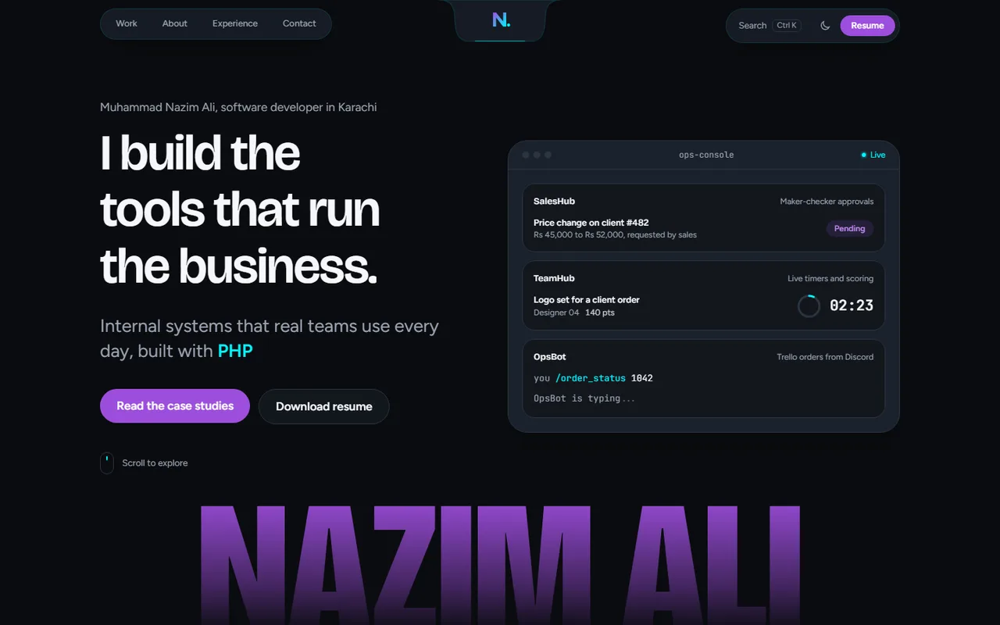

# Muhammad Nazim Ali — Portfolio

Personal portfolio and case studies of the internal tools I build and maintain at Quixotic Creatives.

**Live site:** https://nazimali28.github.io/My-Portfolio/



## What's inside

- **Case studies** for three production tools:
  - **[SalesHub](https://github.com/NazimAli28/SalesHub-PHP-Account-Client-Management-System):** a sales CRM with maker-checker approvals, used by about 50 staff.
  - **[TeamHub](https://github.com/NazimAli28/TeamHub-PHP-Task-Management-System):** a task tracker that scores 12 designers live.
  - **[OpsBot](https://github.com/NazimAli28/OpsBot-Discord-Reminders-Trello-Orders):** a Discord bot for reminders and Trello order lookups.
- **Experience timeline**, machine learning coursework and skills
- **Interactions:** smooth scrolling, scroll-driven animations, a Ctrl+K command menu, and dark and light themes
- **Accessibility:** works without animations when "reduce motion" is on, supports keyboard navigation, and is checked with axe in both themes

## Tech stack

React 19 · TypeScript · Vite · Tailwind CSS v4 · Motion · Lenis · React Router · cmdk · Playwright

## Run locally

Requires Node.js 20 or newer.

Install the dependencies:

```bash
npm install
```

Start the dev server:

```bash
npm run dev
```

Then open http://localhost:5173.

| Command | What it does |
|---|---|
| `npm run build` | Type-check and build to `dist/` |
| `npm run preview` | Serve the production build |
| `npm run lint` | Run ESLint |
| `npm run test:e2e` | Playwright end-to-end and accessibility tests (desktop + mobile) |

## Deployment

Every push to `main` builds the site and publishes it to GitHub Pages through `.github/workflows/deploy.yml`.

The previous version of this portfolio (2023) is kept on the [`old-portfolio`](../../tree/old-portfolio) branch.

## Contact

- Email: nazimalionline@gmail.com
- LinkedIn: [linkedin.com/in/mnazimali](https://www.linkedin.com/in/mnazimali)
